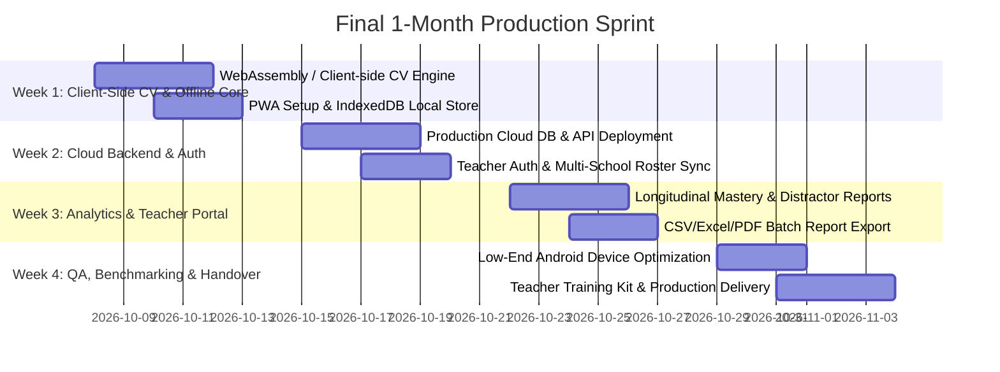

# Production Readiness Roadmap & Engineering Plan (Final 1-Month Sprint)
### Vision-Based Low-Cost Formative Classroom Assessment System
**Partner Organization:** Pi Jam Foundation  
**Course Project:** ET617 (Group 7)  
**Target Timeline:** 4 Weeks (Production Deployment & Client Handover)

---

## 1. Executive Summary & Production Vision

The prototype demonstrates end-to-end viability (ArUco 5×5 localization, geometric answer decoding, HSV color verification, and the 5-question FAST flow). However, **for large-scale deployment across hundreds of partner schools and rural classrooms in India**, the architecture must transition from a *local laptop-server prototype* to an **autonomous, offline-first mobile platform** that teachers can use directly on low-cost Android smartphones without technical overhead.

### The 3 Core Production Pillars:
1. **Zero-Server Classroom Independence (On-Device Client-Side Scanning):** Eliminate the requirement for a local laptop/server by running marker detection directly on the phone via WebAssembly (OpenCV.js) or a standalone PWA/Android bundle.
2. **Offline-First Synchronization (IndexedDB $\rightarrow$ Cloud Central Store):** Capture assessments 100% offline in rural classrooms and auto-sync when network connectivity is restored.
3. **Multi-Tenant Teacher & Administrative Ecosystem:** School/Class roster management, longitudinal student analytics, role-based access control (RBAC), and 1-click Excel/PDF report exports for district coordinators.

---

## 2. 4-Week Milestone Breakdown

---

## 3. Detailed Work Packages

### Week 1: Client-Side Edge Inference & Offline-First Engine
*Goal: Remove dependency on laptop server; scan 100% on the teacher's phone offline.*

1. **Client-Side OpenCV.js / WASM Migration:**
   - Compile/bundle the ArUco 5x5 detector + geometric orientation + HSV validation into client-side WebAssembly (`OpenCV.js` or lightweight custom JS worker).
   - Offload processing to a `Web Worker` so the video stream maintains 30–60 FPS without freezing the teacher UI.
2. **Progressive Web App (PWA) & Service Workers:**
   - Implement `manifest.json` and Cache-First Service Worker so teachers can "Install" the app on any Android/iOS device and open it in airplane mode.
3. **Local Database (IndexedDB / Dexie.js):**
   - Store active school rosters, question sets, and assessment responses locally on the phone.
   - Response queuing with unique local UUIDs to prevent collision during future cloud synchronization.

---

### Week 2: Production Cloud Backend, Security & Multi-Tenancy
*Goal: Deploy a secure central backend with automated synchronization.*

1. **Cloud API & Managed Database Deployment:**
   - Migrate local SQLite to a production-grade cloud database (PostgreSQL on Supabase / Render / AWS RDS).
   - Configure public domain with trusted SSL certificates (Let's Encrypt / Cloudflare) to eliminate self-signed certificate warnings.
2. **Teacher Authentication & Role-Based Access Control (RBAC):**
   - Lightweight OTP/Password login for teachers linked to specific schools and classes.
   - Pi Jam Admin portal to bulk-upload academic rosters via standard Excel/CSV templates (`Grade`, `Section`, `Roll No`, `Student Name`).
3. **Background Two-Way Sync Engine:**
   - Background sync endpoint (`/api/sync/batch`) with exponential backoff and conflict resolution (Server-Wins on roster, Client-Wins on offline test timestamps).

---

### Week 3: Teacher Analytics, Longitudinal Tracking & Exports
*Goal: Turn raw scan data into actionable pedagogical interventions.*

1. **Longitudinal Mastery Tracking:**
   - Track individual student progression over time across multiple assessment sessions (identifying learning decay or sustained growth).
   - Distractor / Misconception Heatmaps: Flag which specific topics/options confused students across sections.
2. **1-Click Export Engine:**
   - Export official school report cards in **Excel (.xlsx)** and printable **PDF summary sheets** for state education departments and Pi Jam coordinators.
3. **Question Bank Management:**
   - Allow teachers/admins to pre-configure question text, option labels, and answer keys, or run rapid "Spontaneous Polls" on the fly.

---

### Week 4: Performance Hardening, Field Testing & Rollout Kit
*Goal: Ensure flawless real-world operation on low-end hardware.*

1. **Low-End Android Optimization (Budget Phones):**
   - Benchmark on phones with 2GB RAM / low-end processors (MediaTek Helio / Snapdragon 400 series).
   - Dynamic frame skipping (e.g. processing at 8–10 FPS while camera displays at 30 FPS).
   - Glare / Reflection Compensation (adaptive thresholding tuning for glossy laminated card surfaces under bright sunlight or dim ceiling tubes).
2. **Production Card Print Kit:**
   - Pre-packaged master PDF set of all 45 cards with optimal CMYK print profiles and lamination guidelines.
3. **Teacher Training & Onboarding Kit:**
   - 1-page visual quick-reference sheet ("3 Steps to Scan a Class in 15 Seconds").
   - Bilingual UI support (English + Hindi / Marathi) for government school teachers.

---

## 4. Key Architectural Delta: Prototype vs. Production

| Feature / Dimension | Current Demo Prototype | Production Release (Target) |
|---|---|---|
| **CV Execution** | Python backend on laptop via WebSockets | Client-side WebAssembly (WASM) / Web Worker on phone |
| **Server Requirement** | Local PC running `run_server.py` | 100% Serverless in-class (Zero laptop needed) |
| **Internet Dependency** | Needs local hotspot / LAN | 100% Offline-Capable (Syncs when internet available) |
| **Data Storage** | Local SQLite (`assessment.db`) | Local IndexedDB + Central Cloud PostgreSQL |
| **SSL / HTTPS** | Self-signed `cert.pem` (manual bypass) | Production Public SSL (Let's Encrypt / HTTPS domain) |
| **Roster Setup** | Hardcoded demo seed (30 students) | Bulk CSV/Excel Roster Upload via Admin Portal |
| **Reporting** | CLI `inspect_db.py` + HTML UI | Exportable Excel, PDF Scorecards & Longitudinal Trends |
| **Hardware Target** | Laptop + Smartphone pair | Standalone commodity Android Phone (₹7,000–₹12,000) |

---

## 5. Next Steps for Today's Alignment

To begin Phase 2 immediately after the client meeting, the following decisions will be confirmed:
1. **Hosting & Cloud Preference:** Deployment target for the central cloud API (Supabase / Render / AWS / GCP).
2. **Client Hardware Profile:** Target smartphone models predominantly used by Pi Jam field staff and government school teachers.
3. **Roster Ingestion Format:** Confirm Pi Jam's existing school roster spreadsheet template for direct import compatibility.
