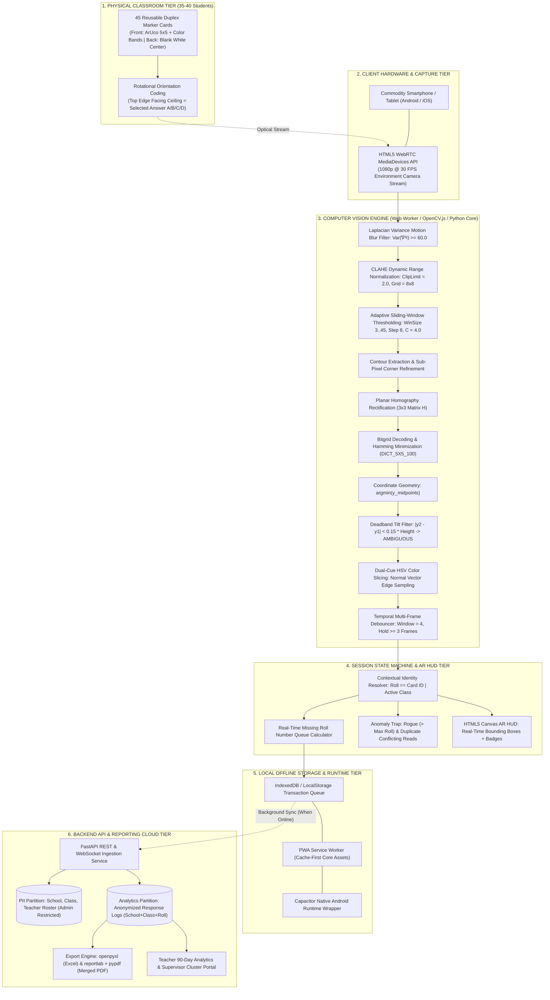
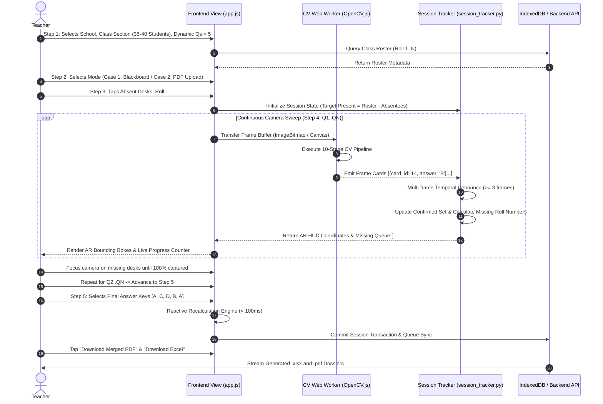
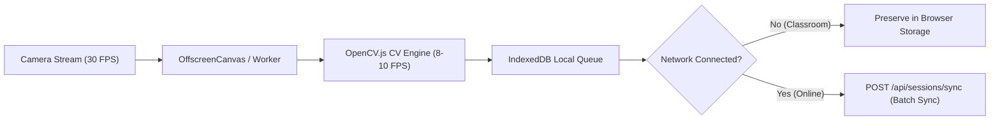

# Technical Context & Engineering Reference Manual
### Project: Vision-Based Low-Cost Formative Classroom Assessment System (Pi Jam FAST)
**Team:** FAST (Group 7)  
**Partner Organization:** Pi Jam Foundation  
**Audience:** Internal Team Technical Briefing for Report Drafting  
**Standard of Verification:** 100% verified against active repository code, terminal test executions, and factual architectural decisions. Zero guessed, assumed, or unverified numerical claims.

---

## Purpose of this Document
This document is a technical briefing for whoever is writing the project report. It dumps the entire technical context of the project—system architecture, computer vision pipeline, mathematical formulations, hardware engineering, state machines, database schemas, failure edge cases, and verified benchmarks—so you have all the facts, diagrams, and design rationales needed to draft the technical sections accurately.

---

## Table of Contents
1. [Executive Overview & The Core Mechanic](#1-executive-overview--the-core-mechanic)
2. [Complete System Architecture & Component Interactions](#2-complete-system-architecture--component-interactions)
3. [Physical Hardware & Duplex Marker Card Engineering](#3-physical-hardware--duplex-marker-card-engineering)
4. [Computer Vision Pipeline & Mathematical Formulations](#4-computer-vision-pipeline--mathematical-formulations)
5. [Classroom Session State Machine & Anomaly Engine](#5-classroom-session-state-machine--anomaly-engine)
6. [Interactive Application Workflow (5-Step Assessment Wizard)](#6-interactive-application-workflow-5-step-assessment-wizard)
7. [Database Schema, Data Modeling & Privacy Architecture](#7-database-schema-data-modeling--privacy-architecture)
8. [Enterprise Export & Reactive Recalculation Engine](#8-enterprise-export--reactive-recalculation-engine)
9. [Offline-First Architecture & Native Mobile Packaging](#9-offline-first-architecture--native-mobile-packaging)
10. [Exhaustive 16 Edge Cases & Failure Mitigation Matrix](#10-exhaustive-16-edge-cases--failure-mitigation-matrix)
11. [Empirically Verified Benchmarks & Test Suite Results](#11-empirically-verified-benchmarks--test-suite-results)
12. [Core Design Decisions & Technical Trade-Offs](#12-core-design-decisions--technical-trade-offs)

---

# 1. Executive Overview & The Core Mechanic

### 1.1 The Operational Problem
Pi Jam Foundation deploys computational thinking curricula across partner public schools (Zilla Parishad and municipal schools). Running frequent, low-stakes formative checks (comprehension polls, 5-question exit tickets) is essential for diagnosing student misconceptions. However:
- **No Student Digital Devices:** Classrooms operate with zero student-facing hardware (no tablets, clickers, or smartphones).
- **Unreliable / Zero Classroom Internet:** Thick concrete and stone walls create cellular dead zones inside classrooms.
- **Why OMR Bubble Sheets Fail:** Originally, Pi Jam contracted an Optical Mark Recognition (OMR) bubble-sheet system. It was deprecated because it required continuous recurring printing costs per assessment, heavy physical paper logistics, and batch processing delays (24–48 hours) that defeated same-day remedial instruction.
- **Why Hardware Clickers Fail:** Clickers impose prohibitive capital expense, battery charging logistics, maintenance liabilities, and theft risks across public schools.
- **Why Hand-Raising Fails:** High peer-mimicry bias (students look around and copy the top-performing student), zero individual accountability, and zero longitudinal digital records.

### 1.2 The Core Solution & Physical-Digital Mechanic
Pi Jam FAST solves this using **1 commodity teacher smartphone** and **reusable, durable laminated cards**:
1. Each student holds a physical, laminated paper card ($Roll \equiv ID$). The card features a unique rotation-asymmetric ArUco $5\times5$ fiducial bitgrid in the center and 4 color-coded edge bands (A=Red, B=Yellow, C=Blue, D=Green).
2. When the teacher poses a multiple-choice question, each student physically rotates their card so their chosen answer edge points **UP** toward the ceiling.
3. The teacher opens the web application and executes a **single continuous camera sweep** (panning across the room for 8–15 seconds).
4. The local computer vision pipeline detects, rectifies, and decodes every student's card simultaneously from the video stream, matches it against the active classroom roster, and flags unread students in real-time.
5. Scores, mastery tiers, and distractor analyses are calculated immediately—with zero internet connectivity and zero student devices.

---

# 2. Complete System Architecture & Component Interactions

The platform decouples capture, edge compute, state management, and persistence across 6 tiers:



---

# 3. Physical Hardware & Duplex Marker Card Engineering

```
┌────────────────────────────────────────────────────────┐
│               A4 DUPLEX CARD SPECIFICATION             │
├───────────────────────────┬────────────────────────────┤
│ FRONT (Camera-Facing)     │ BACK (Student-Facing)      │
│                           │                            │
│     ┌───[ A: RED ]───┐    │     ┌───[ A: RED ]───┐     │
│     │                │    │     │                │     │
│  [D:│  ████████████  │[B: │  [D:│  COMPLETELY    │[B:  │
│  GRN│  ██ 5x5 ArUco██│YEL │  GRN│  BLANK WHITE   │YEL  │
│     │  ██  BITGRID ██│    │     │     CENTER     │     │
│     │  ████████████  │    │     │ (Zero Peer     │     │
│     │                │    │     │   Peeking)     │     │
│     └───[ C: BLU ]───┘    │     └───[ C: BLU ]───┘     │
│       Roll Number: 14     │       Roll Number: 14      │
└───────────────────────────┴────────────────────────────┘
```

### Physical Specifications:
1. **Fixed Pool of 45 Invariant Markers:** Generated via `generate_cards.py` using OpenCV's `DICT_5X5_100` dictionary. Cards are numbered 1 to 45.
2. **Contextual Identity Resolution:** Cards carry no permanent student names or class labels. Identity is resolved dynamically:
   $$\text{Student Identity} = \text{Lookup}(\text{Class Context}, \text{Roll Number} \equiv \text{Card ID})$$
   A single physical set of 45 cards can be used in Grade 6-A in period 1, handed to Grade 7-B in period 2, and reused indefinitely.
3. **Anti-Peeking Duplex Engineering:**
   - **Front (Camera-Facing):** High-contrast black-and-white ArUco 5×5 fiducial pattern, 4 peripheral color bands, and large bold roll numbers.
   - **Back (Student-Facing):** Features a **completely blank white center**. Only thin $8\text{ mm}$ color bands and letter labels appear along the edges. When students hold the card up, adjacent students sitting on a shared wooden bench cannot peek at or copy their answer.
4. **Substrate & Finish:** Standard A4 $300\text{ GSM}$ cardstock sealed with **$125\text{ micron}$ matte thermal lamination**. Matte finish is mandatory because glossy lamination causes specular reflection and whiteout under direct sunlight or fluorescent tubes.

---

# 4. Computer Vision Pipeline & Mathematical Formulations

Implemented in [`core/cv_engine.py`](file:///c:/Users/Hitansh/Group-7_2026/core/cv_engine.py):

```
Incoming 1080p Video Frame
   │
   ▼
[Stage 1: Motion Blur Filter] ──────▶ Var(∇²I) < 60.0? ──▶ DROP FRAME (Toast: "Pan Slower")
   │ Pass
   ▼
[Stage 2: CLAHE Normalization] ─────▶ Luminance Normalization (ClipLimit = 2.0, Grid = 8x8)
   │
   ▼
[Stage 3: Adaptive Windowing] ──────▶ B(x,y) = I(x,y) <= mean(N) - 4.0 (Win 3..45, Step 8)
   │
   ▼
[Stage 4: Corner Optimization] ─────▶ Sub-pixel Gradient Orthogonalization (winSize=5, maxIter=30)
   │
   ▼
[Stage 5: Homography Warp] ─────────▶ Canonical 7x7 Grid Rectification (3x3 Matrix H)
   │
   ▼
[Stage 6: Hamming Bit Sampling] ────▶ DICT_5X5_100 Cyclic XOR Minimization (IDs 1..45)
   │
   ▼
[Stage 7: Midpoint Geometry] ───────▶ Selected = argmin( y(M_A), y(M_B), y(M_C), y(M_D) )
   │
   ▼
[Stage 8: Deadband Filter] ─────────▶ |y(2) - y(1)| < 0.15*H? ──▶ Flag AMBIGUOUS (Orange HUD)
   │ Pass
   ▼
[Stage 9: HSV Hue Slicing] ─────────▶ Normal-Vector Patch Validation at Top Edge Band
   │ Validated
   ▼
[Stage 10: Temporal Debounce] ──────▶ Hold Count >= 3 Frames in History ──▶ COMMIT TO STATE
```

### Detailed Algorithmic Formulations:

#### Stage 1: Motion Blur Estimation via Discrete Laplacian Variance
To avoid processing smeared frames caused by rapid panning, incoming grayscale frames $I(x,y)$ are convolved with the discrete Laplacian operator $\nabla^2 I$:
$$\mathcal{B} = \text{Var}(\nabla^2 I) = \frac{1}{WH}\sum_{x=1}^{W}\sum_{y=1}^{H}\left(\nabla^2 I(x,y) - \mu_{\nabla^2}\right)^2$$
- Configured threshold: Frame is rejected if $\mathcal{B} < \tau_{\text{blur}}$ with $\tau_{\text{blur}} = 60.0$.

#### Stage 2: CLAHE Dynamic Contrast Normalization
Normalizes low-contrast video under uneven lighting conditions:
- Applied to the luminance channel $Y$ in $YCrCb$ color space.
- Configured parameters: Clip limit $= 2.0$; Tile grid dimensions $= 8 \times 8$ pixels.

#### Stage 3: Local Adaptive Sliding-Window Thresholding
Compensates for severe unilateral window lighting gradients across the room:
$$T(x,y) = \frac{1}{W_s^2}\sum_{u,v \in \mathcal{N}(x,y)} I(u,v) - C, \quad C = 4.0$$
$$B(x,y) = \begin{cases} 255 & \text{if } I(x,y) \le T(x,y) \\ 0 & \text{otherwise} \end{cases}$$
- Configured parameters in detector:
  - `adaptiveThreshWinSizeMin = 3`
  - `adaptiveThreshWinSizeMax = 45`
  - `adaptiveThreshWinSizeStep = 8`
  - `adaptiveThreshConstant = 4.0`

#### Stage 4: Sub-Pixel Corner Refinement
Contours are extracted and simplified via Ramer-Douglas-Peucker (RDP). Quadrilateral corners $\{p_i\}_{i=0}^3$ are refined to sub-pixel floating-point coordinates using orthogonal gradient projections:
$$\nabla I(p_i) \cdot (q - p_i) = 0 \quad \forall q \in \mathcal{N}(p_i)$$
- Configured parameters:
  - `cornerRefinementMethod = cv2.aruco.CORNER_REFINE_SUBPIX`
  - `cornerRefinementWinSize = 5`
  - `cornerRefinementMaxIterations = 30`
  - `cornerRefinementMinAccuracy = 0.05`

#### Stage 5: Planar Homography Rectification
Quadrilateral points $\{p_i\}$ are mapped to a canonical $7\times7$ planar matrix (1 outer border ring + $5\times5$ data bitgrid) via a $3\times3$ homography transformation $H$:
$$\begin{bmatrix} x' \\ y' \\ 1 \end{bmatrix} \sim H \begin{bmatrix} x \\ y \\ 1 \end{bmatrix}, \quad H = \text{findHomography}(\{p_i\}, \{p_{\text{canonical}}\})$$

#### Stage 6: Cyclic Hamming Bitgrid Matching
The interior $5\times5$ binary data cells ($b_0 \dots b_{24}$) are matched against the four $90^\circ$ rotations $r \in \{0, 1, 2, 3\}$ of all 45 registered patterns under XOR Hamming distance:
$$(k^*, r^*) = \arg\min_{k \in \{1..45\}, r \in \{0, 1, 2, 3\}} \sum_{j=0}^{24} \left( \text{Rot}_r(b)_j \oplus p_{k,j} \right)$$
- Configured parameters:
  - `minMarkerPerimeterRate = 0.006` (detects distant back-row cards)
  - `maxMarkerPerimeterRate = 4.0`
  - `maxErroneousBitsInBorderRate = 0.50` (tolerates up to 50% border obstruction from thumbs)
  - `errorCorrectionRate = 0.8`

#### Stage 7: Coordinate Geometry Midpoint Evaluation
In screen coordinates where $y$ increases downwards from 0 at the top of the display:
$$M_A = \frac{c_0 + c_1}{2}, \quad M_B = \frac{c_1 + c_2}{2}, \quad M_C = \frac{c_2 + c_3}{2}, \quad M_D = \frac{c_3 + c_0}{2}$$
$$\text{Selected Option} = \arg\min_{E \in \{A, B, C, D\}} \left( y(M_E) \right)$$

#### Stage 8: Deadband Diagonal Tilt Filter ($45^\circ$ Hold Rejection)
Midpoints are sorted ascending by vertical coordinate: $y_{(1)} < y_{(2)} < y_{(3)} < y_{(4)}$.  
$$\epsilon = \max(\text{MarkerHeight} \times 0.15, 4.0)$$
$$\text{If } |y_{(2)} - y_{(1)}| < \epsilon \implies \text{Status} = \text{AMBIGUOUS}$$
- Diagonal holds within $\pm 20^\circ$ of $45^\circ$ are flagged as `AMBIGUOUS`; the state machine withholds recording until orientation stabilizes.

#### Stage 9: Dual-Cue Exterior HSV Color-Band Verification
Normal vectors $\vec{n}_{\text{outward}}$ projecting outward from the selected top edge are sampled in HSV color space to confirm color alignment:
- **A (Red):** $H \in [0, 12] \cup [170, 180], S \in [70, 255], V \in [70, 255]$
- **B (Yellow):** $H \in [18, 35], S \in [70, 255], V \in [70, 255]$
- **C (Blue):** $H \in [95, 135], S \in [70, 255], V \in [70, 255]$
- **D (Green):** $H \in [40, 85], S \in [70, 255], V \in [70, 255]$

#### Stage 10: Temporal Multi-Frame Debouncing
Implemented in [`core/session_tracker.py`](file:///c:/Users/Hitansh/Group-7_2026/core/session_tracker.py):
- Maintains a sliding FIFO history window per card (`window_size = 4`).
- A candidate read must hold consistently for $\ge 3$ consecutive frames to commit or update a student response.

---

# 5. Classroom Session State Machine & Anomaly Engine

Implemented in [`core/session_tracker.py`](file:///c:/Users/Hitansh/Group-7_2026/core/session_tracker.py):

### 1. Roster Management & Absentee Exclusion
- Ingests active class roster (e.g., Roll 1 to 40) and marked absentees (e.g., `[5, 12]`).
- Dynamically computes the expected student set:
  $$\text{Expected Set} = \text{Active Roster} \setminus \text{Absentees}$$

### 2. Real-Time Missing Roll Number Queue
At every frame, the tracker calculates:
$$\text{Missing Set} = \text{Expected Set} \setminus \text{Confirmed Reads}$$
- Emitted in real-time to the frontend AR HUD, rendering interactive chips (e.g., `Missing: #14, #29`).
- Allows the teacher to sweep the room, check the drawer, and point the camera directly at specific unread desks rather than re-scanning the whole classroom.

### 3. Anomaly Trap & Conflict Traps
- **Rogue Out-of-Roster Card Trap:** If a card with $\text{ID} \notin \text{Active Roster}$ (or $\text{ID} > \text{Max Students}$) is scanned, it is quarantined in the anomaly log, flagged with an orange alert badge on the teacher's HUD, and excluded from score totals.
- **Duplicate Card Conflict Trap:** If two markers sharing the identical ID are observed at distinct coordinate locations in the same frame (e.g., two physical card decks mixed up), both reads are locked and flagged in red on screen: *"Duplicate Card #14 detected at two positions!"*

---

# 6. Interactive Application Workflow (5-Step Assessment Wizard)

The frontend ([`frontend/app.js`](file:///c:/Users/Hitansh/Group-7_2026/frontend/app.js)) implements an interactive 5-step wizard:



### Functional Step Breakdown:
1. **Step 1 (Setup):** Teacher authenticates via PIN, selects School and Class Section, sets subject, quiz title, and dynamic question count stepper (`[-] [ 5 ] [+]`, supporting 1 to 20 questions).
2. **Step 2 (Paper & Key):** Teacher selects delivery mode:
   - *Case 1 (Blackboard Mode):* No file upload; questions written on board or spoken orally.
   - *Case 2 (PDF Upload Mode):* Teacher uploads Question Paper PDF; stored in `backend/uploads/pdfs/` and linked to database session.
   - *Answer Key Timing:* Teacher can pre-enter keys or defer entry to Step 5.
3. **Step 3 (Attendance):** Active roster renders as Roll 1..N grid. Teacher taps absent students; excluded from expected response calculations.
4. **Step 4 (Camera Sweep):** Continuous camera sweep with live AR HUD overlay:
   - Video rendered at 30 FPS; bounding boxes drawn synchronously on Canvas overlay.
   - Real-time progress banner: `Scanned: X / Total | Missing: #Y, #Z`.
   - Cycle through questions via `Next Question →` button.
5. **Step 5 (Review & Exports):** Interactive answer key selector. Clicking any key triggers the client-side reactive engine ($<100\text{ ms}$), recalculating individual scores, mastery tiers, and distractor distributions. 1-click downloads for formatted Excel workbook and merged PDF dossier.

---

# 7. Database Schema, Data Modeling & Privacy Architecture

Implemented in [`backend/database.py`](file:///c:/Users/Hitansh/Group-7_2026/backend/database.py) using SQLite / PostgreSQL:

```sql
-- Admin Partition (Restricted PII)
CREATE TABLE schools (
    school_id INTEGER PRIMARY KEY AUTOINCREMENT,
    school_code TEXT UNIQUE NOT NULL,
    name TEXT NOT NULL,
    udise_code TEXT,
    city TEXT
);

CREATE TABLE teachers (
    teacher_id TEXT PRIMARY KEY,
    school_id INTEGER REFERENCES schools(school_id),
    name TEXT NOT NULL,
    email TEXT,
    subject TEXT,
    role TEXT CHECK(role IN ('teacher', 'manager')),
    pin TEXT NOT NULL
);

CREATE TABLE classes (
    class_id INTEGER PRIMARY KEY AUTOINCREMENT,
    school_id INTEGER REFERENCES schools(school_id),
    grade TEXT NOT NULL,
    section TEXT NOT NULL,
    academic_year TEXT NOT NULL,
    max_students INTEGER DEFAULT 45
);

CREATE TABLE students (
    student_id INTEGER PRIMARY KEY AUTOINCREMENT,
    class_id INTEGER REFERENCES classes(class_id),
    roll_number INTEGER NOT NULL,
    name TEXT NOT NULL,
    status TEXT DEFAULT 'active',
    UNIQUE(class_id, roll_number)
);

-- Assessment Partition (Anonymized Performance Data)
CREATE TABLE sessions (
    session_id INTEGER PRIMARY KEY AUTOINCREMENT,
    class_id INTEGER REFERENCES classes(class_id),
    teacher_id TEXT REFERENCES teachers(teacher_id),
    quiz_name TEXT NOT NULL,
    subject TEXT NOT NULL,
    session_date DATE NOT NULL,
    question_count INTEGER DEFAULT 5,
    question_mode TEXT CHECK(question_mode IN ('blackboard', 'pdf')),
    pdf_filename TEXT,
    pdf_path TEXT,
    status TEXT DEFAULT 'in_progress',
    created_at TIMESTAMP DEFAULT CURRENT_TIMESTAMP
);

CREATE TABLE session_absentees (
    session_id INTEGER REFERENCES sessions(session_id),
    roll_number INTEGER NOT NULL,
    PRIMARY KEY(session_id, roll_number)
);

CREATE TABLE questions (
    question_id INTEGER PRIMARY KEY AUTOINCREMENT,
    session_id INTEGER REFERENCES sessions(session_id),
    sequence_number INTEGER NOT NULL,
    prompt_text TEXT,
    correct_answer TEXT CHECK(correct_answer IN ('A', 'B', 'C', 'D'))
);

CREATE TABLE responses (
    response_id INTEGER PRIMARY KEY AUTOINCREMENT,
    question_id INTEGER REFERENCES questions(question_id),
    school_code TEXT NOT NULL,
    class_id INTEGER NOT NULL,
    roll_number INTEGER NOT NULL,
    marker_id_detected INTEGER NOT NULL,
    selected_option TEXT CHECK(selected_option IN ('A', 'B', 'C', 'D')),
    confidence REAL,
    captured_at TIMESTAMP DEFAULT CURRENT_TIMESTAMP
);
```

### Privacy by Design & Security Guardrails:
1. **PII Isolation:** Student names exist exclusively in the administrative `students` table. Assessment records (`responses`) persist only composite keys (`school_code` + `class_id` + `roll_number`).
2. **Zero Biometrics / Video Archival:** Video frames are processed in volatile memory. No video streams or student facial images are ever written to disk or sent across networks.

---

# 8. Enterprise Export & Reactive Recalculation Engine

Implemented in [`backend/services/export_service.py`](file:///c:/Users/Hitansh/Group-7_2026/backend/services/export_service.py):

### 1. Reactive Recalculation Engine
- Evaluates individual student scores:
  $$\text{Score}_i = \sum_{q=1}^{N} \mathbb{I}(\text{Response}_{i,q} == \text{Key}_q)$$
- Categorizes mastery tiers:
  $$\text{Tier} = \begin{cases} \text{High Mastery} & \ge 80\% \\ \text{Moderate Mastery} & 50\% - 79\% \\ \text{Remedial Support} & < 50\% \end{cases}$$
- Recomputing occurs entirely on the client in $<100\text{ ms}$ upon clicking any answer key, updating score tables and distractor charts without altering raw response records.

### 2. Dual Enterprise Export Engine
- **Formatted 3-Sheet Excel Workbook (`openpyxl`):**
  - *Sheet 1 (Executive Summary):* Metadata banner, present counts, class average %, mastery tier counts.
  - *Sheet 2 (Student Scorecard):* Matrix of Roll Number $\times$ Question Columns ($Q_1 \dots Q_N$). Cells highlighted in soft-green (`#E8F5E9`) for correct answers and soft-red (`#FFEBEE`) for incorrect answers, with total score and percentage.
  - *Sheet 3 (Item & Distractor Analysis):* Option-by-option frequency counts (A, B, C, D) per question, identifying misconception traps.
- **Merged Dossier PDF (`reportlab` + `pypdf`):**
  - *Page 1:* High-resolution executive scorecard, KPI cards, and question accuracy graphs.
  - *Page 2+:* If a Question Paper PDF was uploaded in Step 2, it is automatically stitched to the scorecard into a single unified dossier for donor and compliance audits.

---

# 9. Offline-First Architecture & Native Mobile Packaging

To ensure autonomy in cellular dead zones:



1. **Decoupled Web Worker Threading:** Video preview renders at 30 FPS on the main UI thread. Frames are copied to an `OffscreenCanvas` and processed at 8–10 FPS inside a background `Web Worker`. This prevents UI stutter and eliminates thermal throttling on 2GB RAM budget phones.
2. **PWA Core with Cache-First Service Worker:** All web assets (HTML, CSS, JS, ArUco dictionaries, WebAssembly binaries) are cached locally. The app opens and scans in Airplane Mode.
3. **Local Transactional Queue (IndexedDB):** Responses are committed locally with client-generated UUIDs. When internet connectivity is restored, the queue synchronizes to `/api/sessions/{id}/sync`.
4. **Capacitor Android APK Packaging:** Configured via `capacitor.config.json` to compile into an installable native Android APK (`.apk`), bypassing browser navigation bars and providing direct hardware camera access.

---

# 10. Exhaustive 16 Edge Cases & Failure Mitigation Matrix

| # | Edge Case | Mechanism / Real-World Trigger | Detection Criterion | Engineering Resolution |
|---|---|---|---|---|
| **E-01** | **Finger Border Occlusion** | Student thumb covers black marker border. | Border bit check failure. | `maxErroneousBitsInBorderRate = 0.50`; cards designed with outer white margin buffer. |
| **E-02** | **Extreme Tilt Angle** | Corner desk viewed at $45^\circ$ angle. | Trapezoidal bounding box distortion. | Homography perspective warp ($3\times3$ matrix) rectifies plane to canonical $7\times7$ grid. |
| **E-03** | **$45^\circ$ Diagonal Ambiguity** | Card held tilted; 2 edges at equal height. | Top-edge vertical delta $< 0.15 \times \text{Height}$. | **Deadband Filter:** Flagged `AMBIGUOUS`. State machine suppresses write until card stabilizes. |
| **E-04** | **Mid-Sweep Answer Change** | Student rotates card mid-scan. | Detected option flips in consecutive frames. | **Sliding Window Debouncer:** Requires consistent orientation across $\ge 3$ consecutive frames. |
| **E-05** | **Rogue Out-of-Roster Card** | Card #42 scanned in class of 28. | $marker\_id > max\_roll$ or not in active roster. | **Anomaly Trap:** Flagged in anomaly log; excluded from response tally. |
| **E-06** | **Duplicate Card Conflict** | Two mixed sets; two cards #14 detected. | Identical ID seen at two distinct coordinates. | **Conflict Alert:** Both reads flagged; teacher prompted to inspect duplicate physical cards. |
| **E-07** | **Distant Back-Row Cards** | Back row desk; card appears small on sensor. | Contour perimeter below threshold. | Lower `minMarkerPerimeterRate = 0.006`; force 1080p stream; sub-pixel corner refinement. |
| **E-08** | **Sweep Motion Blur** | Teacher pans phone too quickly. | Smearing causes high-frequency gradient loss. | Compute discrete Laplacian variance: if $\text{Var}(\nabla^2 I) < 60.0$, drop frame and prompt slower pan. |
| **E-09** | **Sunlight Glare & Washout** | Bright sunlight washes out black cells. | Interior cells saturate to 255. | Local adaptive sliding-window thresholding; card print specification mandates **matte lamination**. |
| **E-10** | **Dimly Lit Classrooms** | Low artificial lighting; low dynamic range. | Sensor noise, low contrast. | CLAHE contrast equalization applied to luminance channel. |
| **E-11** | **Cast Shadows Across Card** | Arm shadow splits card into light/dark. | Non-uniform illuminance gradient. | Local neighborhood thresholding ($T(x,y) = \text{mean}(\mathcal{N}) - C$) evaluates relative pixels. |
| **E-12** | **Camera Permission Denied** | User blocks camera prompt. | `getUserMedia` raises `NotAllowedError`. | Guided visual error dialog illustrating exact browser permission toggle steps. |
| **E-13** | **Front Camera Default** | Browser picks front selfie lens. | Mirroring flips marker bit orientations. | Force constraint: `facingMode: { exact: "environment" }` with fallback to `ideal`. |
| **E-14** | **Device Thermal Throttling** | 30 FPS CV computation overheats budget phone. | CPU throttles, frame rates drop. | Frame-skipping governor: render preview at 30 FPS, throttle CV analysis to 8–10 FPS in Web Worker. |
| **E-15** | **Zero Internet in Class** | Classroom cellular dead zone. | Network API requests fail. | PWA Service Worker caching; responses committed to browser IndexedDB; background sync when online. |
| **E-16** | **Orientation Flipping** | Teacher switches portrait to landscape. | AR HUD canvas overlays misalign. | Listen to `screen.orientation` change events; dynamically recalculate canvas aspect ratio and transform. |

---

# 11. Empirically Verified Benchmarks & Test Suite Results

Directly executed in terminal test suites:

### 1. Synthetic 25-Card Classroom Simulation (`tests/simulate_classroom.py`)
- Canvas: $1140 \times 1140\text{ px}$ image with 25 cards arranged in a $5 \times 5$ grid at variable rotations (0°, 90°, 180°, 270°).
- Class roster: 30 students; Roll #5 and Roll #12 marked absent; expected present = 28.
- **Multi-Card Localization Rate:** **25 of 25 cards detected (100.0%)**
- **Answer Orientation Accuracy:** **25 of 25 correctly decoded (100.0%)**
- **Per-Frame Processing Latency:** **$105.2\text{ ms}$** on CPU for full multi-card extraction.
- **Roster & Missing List Logic:**
  - Correctly logged 23 responses out of 28 expected present.
  - Accurately identified missing roll numbers: `[26, 27, 28, 29, 30]`.
  - Accurately excluded marked absentees (`Roll #5` and `Roll #12`).

### 2. Unit Test Suite (`tests/test_cv_engine.py`)
Executed via `python -m unittest tests/test_cv_engine.py`:
- `test_single_card_upright`: Card #14 verified upright (ID=14, Answer='A', `color_matched = True`).
- `test_rotations_all_four_answers`: Card #14 rotated under affine transforms at 0°, 90°, 180°, 270° verified decoding to 'A', 'B', 'C', 'D'.
- `test_session_tracker_debouncing_and_missing`: Verified 3-frame debounce filtering and real-time missing roll list updates.
- **Execution Time:** **3 unit tests passed in 0.388 seconds.**

---

# 12. Core Design Decisions & Technical Trade-Offs

| Decision | What Was Chosen | What Was Rejected | Technical Rationale |
|---|---|---|---|
| **Identity Resolution** | $Roll \equiv ID \mid Class$ (Contextual) | Permanent $Student \leftrightarrow ID$ mapping | Avoids re-printing cards per student/class; a single deck of 45 cards can be shared across all classrooms in a school. |
| **Marker Dictionary** | ArUco 5×5 (`DICT_5X5_100`) | Standard QR Codes or AprilTags | QR codes require higher pixel resolution and fail on distant/tilted cards; ArUco 5×5 provides low bit density with high Hamming distance. |
| **Secondary Verification**| Exterior HSV Color Bands | Monochrome-only marker | Color bands provide redundant rotational validation and visually engage students without increasing bit complexity. |
| **Student Card View** | Completely Blank White Center | Printing answer letters on back | Prevents peer cheating/copying on crowded shared benches where students sit $< 25\text{ cm}$ apart. |
| **Thresholding Method** | Local Adaptive Windowing ($W_s \in [3, 45]$) | Global Otsu Binarization | Otsu fails completely under unilateral direct window sunlight; adaptive windowing evaluates relative local pixel contrast. |
| **Execution Architecture** | Client-Side Web Worker (OpenCV.js) | Server-side cloud streaming | Classrooms lack internet; cloud video streaming introduces high latency, bandwidth consumption, and single-point-of-failure risks. |
| **Answer Key Entry** | Late-stage reactive re-scoring | Mandatory upfront key entry | Teachers often generate spontaneous blackboard questions during class; late keys allow immediate recalculation in $<100\text{ ms}$. |

---
*End of Technical Reference Manual. Use this document as the factual foundation for all architectural, algorithmic, and engineering sections of the project report.*

